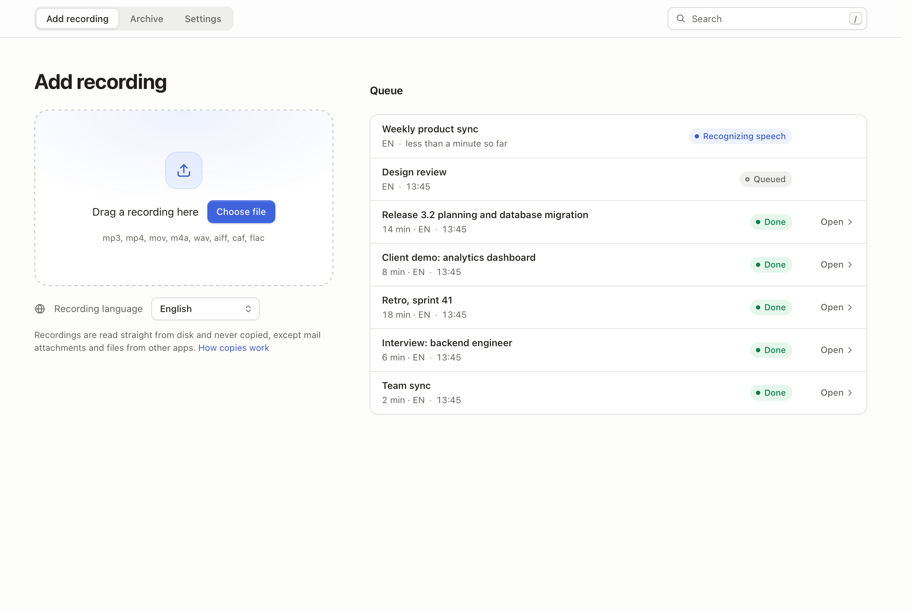
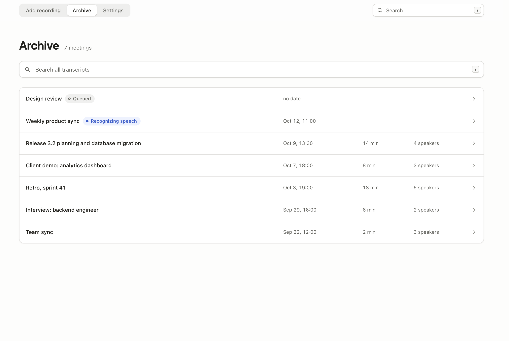
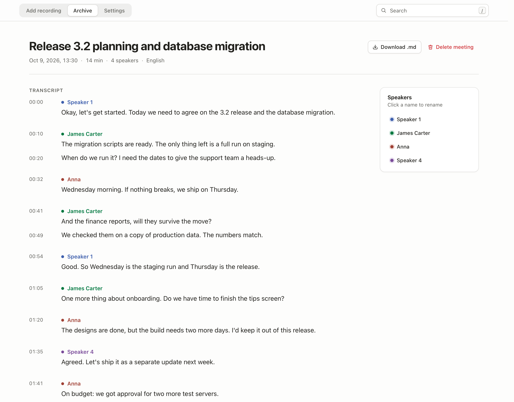

# LocTranscriptor

Local transcription for meetings on your Mac.

Add a meeting recording and get a word-for-word transcript split by speaker. Search works across all your meetings. Everything runs on your Mac: no cloud speech service, no account, no telemetry.



- **Fast.** Speech recognition and speaker diarization run on the Apple Neural Engine via [FluidAudio](https://github.com/FluidInference/FluidAudio). A two-hour meeting takes about 1.5 minutes on a MacBook Air M3 with 16 GB.
- **Verbatim.** The transcript keeps every word, with timestamps and speakers (`Speaker 1`, `Speaker 2` and so on). Click a speaker to give them a real name. No summaries, no rewriting.
- **Private.** The interface listens only on `127.0.0.1`. Recognition runs in a child process that macOS sandboxes with no network access. Recordings are read where they are and never copied. A file dropped into the browser is a temporary copy. It is deleted after processing, or kept for up to 7 days if processing fails, so you can retry.
- **Low upkeep.** It starts at login, restarts itself after a crash and lives in the menu bar. Everything is stored in one SQLite file with full-text search.

| | |
|---|---|
|  |  |

## Download for Mac

**[Download LocTranscriptor.dmg](https://github.com/zorki2020/transcribator/releases/latest/download/LocTranscriptor.dmg)** · [all releases](https://github.com/zorki2020/transcribator/releases)

It is a regular Mac app, no Terminal needed. Русская инструкция [ниже](#установка-на-mac-по-русски).

You need a Mac with Apple Silicon (M1 or newer), macOS 15 Sequoia or newer and about 2 GB of free disk space. On an Intel Mac or an older macOS, macOS itself will not open the app.

1. Open `LocTranscriptor.dmg` and drag **LocTranscriptor** into **Applications**.
   <!-- screenshot: dmg window -->
2. Open LocTranscriptor from Applications. macOS shows **“LocTranscriptor” Not Opened**. Click **Done**. This is expected, the reason is below.
   <!-- screenshot: Not Opened dialog -->
3. Open **System Settings → Privacy & Security** and scroll down to *“LocTranscriptor” was blocked to protect your Mac*. Click **Open Anyway**, confirm with your password or Touch ID, then click **Open**. The button stays there for about an hour after step 2. If it is gone, repeat step 2. You do this only once.
   <!-- screenshot: Open Anyway -->
4. On the first screen click **Download models**. The app downloads the speech models, about 650 MB from huggingface.co. This is the only time it goes online. If the download breaks off, it resumes where it stopped.
5. Add a recording: click **Choose file** or drag the file from Finder into the window. Supported formats: mp3, mp4/mov, m4a, wav, aiff, caf, flac.

On first launch the app shows a few tips. **Help → Show Tips** brings them back.

**Why the warning?** Apple shows it for every app that is not signed with a paid Apple Developer certificate. LocTranscriptor is open source, and `scripts/build_app.sh` builds it from this repository. To check that your download is the published one, compare the output of `shasum -a 256 ~/Downloads/LocTranscriptor.dmg` with `LocTranscriptor.dmg.sha256` on the release page.

**Closing and quitting.** When you close the window, LocTranscriptor stays in the menu bar and keeps processing. **Quit LocTranscriptor** (⌘Q) stops it. A recording that was cut off starts over at the next launch. To have the app ready after a restart, turn on **Open at Login** in the app menu.

**Updating.** Download the new `.dmg` and replace the app in Applications. Your meetings and models stay. macOS will ask for **Open Anyway** again. It may also ask again for access to folders and for the login item.

**Where your data is.** Meetings, models and settings are in `~/Library/Application Support/LocTranscriptor`. The log, with error codes only, is in `~/Library/Logs/LocTranscriptor`. **Show in Finder** in Settings opens the data folder.

**Uninstall.** Turn off **Open at Login** if it is on. Quit LocTranscriptor and drag it from Applications to the Trash. To delete your meetings and the models too, delete both folders above (Finder → Go → Go to Folder…).

### Установка на Mac (по-русски)

**[Скачать LocTranscriptor.dmg](https://github.com/zorki2020/transcribator/releases/latest/download/LocTranscriptor.dmg)** · [все версии](https://github.com/zorki2020/transcribator/releases)

Это обычное приложение для Mac, Терминал не нужен.

Нужен Mac на Apple Silicon (M1 и новее), macOS 15 Sequoia или новее и около 2 ГБ свободного места. На Mac с Intel и на старой macOS система сама не даст открыть приложение.

1. Откройте `LocTranscriptor.dmg` и перетащите **LocTranscriptor** в папку **Программы**.
2. Откройте приложение из папки «Программы». macOS напишет **«LocTranscriptor» не открыто**. Нажмите **Готово**. Так и должно быть, причина ниже.
3. Откройте **Системные настройки → Конфиденциальность и безопасность** и прокрутите вниз до строки *«LocTranscriptor» заблокировано для защиты Mac*. Нажмите **Всё равно открыть**, подтвердите паролем или Touch ID и нажмите **Открыть**. Кнопка видна около часа после шага 2. Если её нет, повторите шаг 2. Это нужно сделать один раз.
4. На первом экране нажмите **Скачать модели**. Приложение загрузит модели распознавания, около 650 МБ с huggingface.co. Только в этот момент оно выходит в интернет. Если загрузка прервётся, она продолжится с того же места.
5. Добавьте запись: нажмите **Выбрать файл** или перетащите файл из Finder в окно. Форматы: mp3, mp4/mov, m4a, wav, aiff, caf, flac.

При первом запуске приложение покажет несколько подсказок. Чтобы увидеть их снова, выберите **Справка → Показать подсказки**.

**Почему предупреждение?** Apple показывает его для любого приложения без платного сертификата разработчика. Код приложения открыт, его собирает из этого репозитория скрипт `scripts/build_app.sh`. Чтобы убедиться, что файл тот самый, сравните вывод `shasum -a 256 ~/Downloads/LocTranscriptor.dmg` с файлом `LocTranscriptor.dmg.sha256` на странице релиза.

**Закрыть и выйти.** Если закрыть окно, приложение останется в строке меню и продолжит обработку. **Завершить LocTranscriptor** (⌘Q) останавливает его. Прерванная запись начнётся заново при следующем запуске. Чтобы приложение само открывалось после перезагрузки, включите **Открывать при входе** в меню приложения.

**Обновление.** Скачайте новый `.dmg` и замените приложение в папке «Программы». Встречи и модели сохранятся. macOS снова попросит нажать **Всё равно открыть**. Возможно, она заново спросит доступ к папкам и разрешение на запуск при входе.

**Где данные.** Встречи, модели и настройки лежат в `~/Library/Application Support/LocTranscriptor`. Журнал только с кодами ошибок лежит в `~/Library/Logs/LocTranscriptor`. Папку данных открывает кнопка **Показать в Finder** в настройках.

**Удаление.** Если включено **Открывать при входе**, выключите его. Завершите приложение и перетащите его из папки «Программы» в Корзину. Чтобы удалить встречи и модели, удалите обе папки выше (Finder → Переход → Переход к папке…).

## Languages

The transcriber was built for and tested mainly on **Russian** meetings. **English** is
supported too: on the English synthetic test meeting it scored 0% word error rate (0.5% on
the two-hour version) with both speakers correctly separated (details in [Benchmarks](#benchmarks)). You pick the language
per recording on the upload page. The interface itself is available in English and Russian.

The underlying model (Parakeet TDT 0.6B v3) covers 25 European languages; only Russian and
English are wired into the UI and tested.

## Install from source (for developers)

The app above is the easy way. This section builds the service from source with `uv`. Here it keeps its development name, `transcribator`. It runs in your browser at `http://127.0.0.1:8765` and keeps its data in `~/Library/Application Support/transcribator`, apart from the app. To build the app yourself, run `scripts/build_app.sh` (Apple Silicon, macOS 15+, Swift 6.2). It produces `dist/LocTranscriptor.dmg`.

### Requirements

- Mac with Apple Silicon (M1 or newer), macOS 15 Sequoia or newer
- About 3 GB of free disk space (models ~1 GB, build files ~0.7 GB)
- An internet connection once, during installation, to download tools and models

### Install

Run these in Terminal, one block at a time.

**1. Command Line Tools with the macOS 15 SDK** (skip if `xcrun --show-sdk-version` prints 15 or higher)

```bash
xcode-select --install
```

If that says the tools are already installed but the SDK is older than 15, make
Software Update offer the newer tools and install them:

```bash
touch /tmp/.com.apple.dt.CommandLineTools.installondemand.in-progress
softwareupdate --list | grep -A1 "Command Line Tools"
sudo softwareupdate -i "Command Line Tools for Xcode-26.x"   # use the exact label from the list
rm /tmp/.com.apple.dt.CommandLineTools.installondemand.in-progress
```

**2. Homebrew, FFmpeg and uv**

```bash
/bin/bash -c "$(curl -fsSL https://raw.githubusercontent.com/Homebrew/install/HEAD/install.sh)"
brew install ffmpeg uv
```

**3. Swift 6.2** (needed to build FluidAudio; installs into your home folder, no admin rights)

```bash
curl -O https://download.swift.org/swiftly/darwin/swiftly.pkg
pkgutil --check-signature swiftly.pkg   # should say: Developer ID Installer: Swift Open Source
installer -pkg swiftly.pkg -target CurrentUserHomeDirectory
~/.swiftly/bin/swiftly init --quiet-shell-followup
~/.swiftly/bin/swiftly install 6.2
```

**4. The transcribator service**

```bash
git clone https://github.com/zorki2020/transcribator.git ~/transcribator
cd ~/transcribator
scripts/install_fluidaudio.sh        # builds FluidAudio v0.17.7 from source, ~3 minutes
uv sync                              # Python environment
uv run transcribator models download # speech models, ~1 GB, the only step that downloads models
```

**5. Start at login and the menu bar icon**

```bash
scripts/build_menubar.sh             # builds ~/Applications/Transcribator.app
uv run transcribator autostart install
```

macOS may show "Background items added" — that is expected. The service is now running and
a waveform icon appears in the menu bar.

Prefer to run it only when you need it? Skip step 5 and start it by hand:
`cd ~/transcribator && uv run transcribator serve`, stop with Ctrl+C.

## Use

1. Click the waveform icon in the menu bar → **Open LocTranscriptor** (or go to
   <http://127.0.0.1:8765>).
2. On **Add recording**, choose the recording language, then click **Choose file** (opens a
   Finder dialog, and the file is read in place) or drag a file onto the page. mp3, mp4,
   m4a, wav and anything else FFmpeg can read with an audio track will do. Screen
   recordings in mp4 work directly.
3. Watch the queue: *Queued* → *Processing* → *Done*. Processing continues with the browser
   tab closed. One recording is processed at a time.
4. Open the meeting from the queue or from **Archive**. There you can:
   - click a speaker to rename them everywhere in the transcript;
   - edit the title and date in place (Enter saves, Esc cancels);
   - **Download .md** to get a Markdown file;
   - delete the meeting with everything stored about it.
5. **Archive** lists all meetings by date; the search box (press `/`) searches every
   transcript, ignores case, and jumps to the exact line.

The menu bar icon shows the queue state and lets you **Stop**/**Start** the service and
toggle **Start at login**. Quitting the icon does not stop the service.

### Command line

```bash
uv run transcribator process recording.mp4 --language en   # transcript next to the file
uv run transcribator bench recording.mp4 --language en     # timings and memory only
uv run transcribator autostart status
```

## Where things are

| What | Where |
|---|---|
| Meetings database and temporary uploads | `~/Library/Application Support/transcribator/` (folder 700, files 600) |
| Service log (address and error codes only) | `~/Library/Logs/transcribator/serve.log` |
| FluidAudio binary and speech model | `~/.local/share/transcribator-tools/fluidaudio/` |
| Diarization model | `~/Library/Application Support/FluidAudio/Models/speaker-diarization/` |

`TRANSCRIBATOR_TOOLS_DIR` moves the FluidAudio folder (set it for both
`scripts/install_fluidaudio.sh` and the service).
| Login items | `~/Library/LaunchAgents/local.transcribator*.plist` |

Settings (environment variables; `autostart install` copies the current values into the
login item, so run it again after changing them):
`TRANSCRIBATOR_UI_LANG=en|ru` (interface), `TRANSCRIBATOR_LANGUAGE=en|ru` (default
recording language), `TRANSCRIBATOR_DATA_DIR` (database location).

## Privacy model

What is enforced:

- The server binds only to `127.0.0.1`; requests with another `Host` are rejected (DNS
  rebinding), state-changing requests need the page's `Origin` and a CSRF token, and a
  strict Content-Security-Policy forbids any external script, style or font.
- Speech recognition runs in a separate process under `sandbox-exec` with all networking
  denied; the models cannot reach the internet even if they tried.
- No request log, no telemetry. Logs and errors contain codes, never file names or text.
- Temporary audio is deleted on every exit path, including crashes (cleaned on the next
  start).

What it does not protect against: someone with access to your unlocked Mac. Turn on
FileVault, and keep the data folder out of iCloud/Dropbox sync.

## Benchmarks

MacBook Air M3, 16 GB, macOS 15.6, on power. Synthetic meetings generated with
`scripts/make_synthetic_meeting.sh` (macOS voices, two speakers), and the same audio looped
to two hours.

| Recording | Time | Speed | Extra memory | Speakers found | Word error rate |
|---|---|---|---|---|---|
| Russian, 36 s | 1 s | 40× real time | +0.3 GB | 2 of 2 | 1.3%¹ |
| Russian, 2 h | 1 min 28 s | 82× real time | +1.4 GB, no swap | 2 of 2 | 1.4% |
| English, 34 s | 1 s | 24× real time | +0.2 GB | 2 of 2 | 0.0% |
| English, 2 h | 1 min 40 s | 72× real time | +2.1 GB, no swap | 2 of 2 | 0.5% |

¹ The only error: numbers are written as digits ("2 days" instead of "two days").

Synthetic speech is cleaner than a real call: expect more errors with crosstalk, accents and
noisy microphones. Before settling on FluidAudio the project compared it with parakeet-mlx + Senko and
mlx-whisper + Senko: FluidAudio was 3–11× faster, used the least memory and had the lowest
error rate on the two-hour test.

## Development

```bash
uv sync
uv run pytest            # tests use synthetic audio and fake models only
uv run ruff check . && uv run mypy src
```

Code layout: `src/transcribator/pipeline/` (audio, diarization/word alignment, Markdown),
`backends/fluidaudio.py` (calls `fluidaudiocli`), `storage/` (SQLite, FTS5, job queue),
`worker/` (one job at a time, sandboxed), `web/` (FastAPI + Jinja2 + htmx),
`autostart.py` (LaunchAgents), `macos/MenuBar/` (Swift menu bar app).

## Uninstall (source install)

```bash
cd ~/transcribator && uv run transcribator autostart remove
rm -rf ~/Applications/Transcribator.app ~/.local/share/transcribator-tools ~/Library/Logs/transcribator
rm -rf "$HOME/Library/Application Support/transcribator"   # deletes all your transcripts
rm -rf ~/transcribator
```

## Licenses

LocTranscriptor, including the `transcribator` package, is MIT-licensed (`LICENSE`). The speech models are CC-BY-4.0: Parakeet TDT 0.6B v3 by NVIDIA and the pyannote Community-1 diarization pipeline, both converted to CoreML by FluidInference. FluidAudio is Apache-2.0, htmx is 0BSD. [THIRD_PARTY_NOTICES.md](THIRD_PARTY_NOTICES.md) has the full list and what each license requires.
